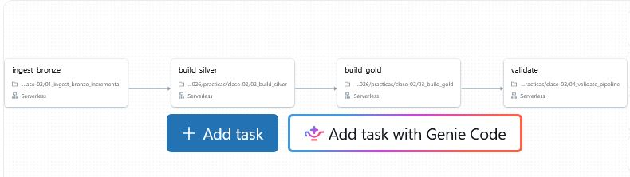

Clase práctica 2 — Silver, Gold y orquestación

1. Datos del estudiante

Nombre: Melisa Casella

Student ID: melisa_casella

Escala: small

Proyecto: Práctica 2 — Silver, Gold y orquestación

2. Lakeflow Job

Se creó un Lakeflow Job para ejecutar automáticamente las cuatro tareas del pipeline, utilizando Serverless como entorno de ejecución.

Nombre del Job: bigdata_melisa_casella_silver_gold

URL del Job: https://dbc-894f8763-2aaf.cloud.databricks.com/jobs/711621953516368/tasks?o=7474647377882574

DAG de ejecución

El Job está compuesto por cuatro tareas con dependencias secuenciales:

ingest_bronze: ejecuta 01_ingest_bronze_incremental.ipynb.

build_silver: ejecuta 02_build_silver.ipynb.

build_gold: ejecuta 03_build_gold.ipynb.

validate: ejecuta 04_validate_pipeline.ipynb.

Las dependencias garantizan que cada tarea se ejecute únicamente cuando la anterior finaliza correctamente.

Captura del DAG:

3. Ejecuciones del pipeline:
   
Resultados de la primera y segunda ejecución:

La comparación de las ejecuciones de batch_002 confirmó que el pipeline es idempotente. Las dos ejecuciones registraron 50.149 filas en Silver, 53 en cuarentena, 598 filas en Gold y un monto total de 50.286.183,33. La columna idempotence_compared registró el valor true en ambas ejecuciones, demostrando que las métricas de negocio permanecieron estables al volver a ejecutar el Job sin generar archivos nuevos.

Cantidades aceptadas y rechazadas para batch_002:

El lote batch_002 registró 200 transacciones aceptadas y 2 transacciones rechazadas, con un total de 202 registros. Las transacciones aceptadas superaron las reglas de calidad y fueron incorporadas a Silver, mientras que las 2 rechazadas fueron almacenadas en silver_transactions_quarantine para conservar su trazabilidad y el motivo de rechazo.

4. Diferencia entre COPY INTO y MERGE

COPY INTO y MERGE resuelven problemas diferentes dentro del pipeline.

COPY INTO se utiliza en la capa Bronze para realizar la ingesta incremental de archivos. Permite incorporar archivos nuevos y evita volver a cargar archivos físicos que ya fueron procesados.

Por otro lado, MERGE se utiliza en la capa Silver para resolver duplicados de negocio y aplicar correcciones sobre las transacciones existentes. Compara los registros mediante transaction_id y actualiza una transacción cuando encuentra una versión más reciente, o inserta una nueva cuando todavía no existe.

En conclusión, COPY INTO evita cargar varias veces el mismo archivo físico, mientras que MERGE evita duplicar transacciones y permite mantener actualizada la información de negocio.

5. Grano de las tablas Gold

Las tablas Gold contienen información agregada y preparada para realizar análisis de negocio. Cada una tiene un grano diferente:

gold_daily_sales: su grano corresponde a una combinación de fecha, país, categoría y canal de pago. Cada fila representa las métricas de ventas correspondientes a esa combinación, incluyendo monto total, cantidad de transacciones y fraudes.

gold_customer_risk: su grano corresponde a un cliente. Cada fila representa información agregada sobre el comportamiento y el nivel de riesgo de un cliente.

gold_batch_summary: su grano corresponde a un lote de procesamiento (source_batch_id). Cada fila representa el resumen de un lote, incluyendo la cantidad de transacciones aceptadas y rechazadas.

Definir el grano permite comprender qué representa cada registro, interpretar correctamente las métricas y evitar errores al realizar agregaciones y comparaciones.

6. Visualizaciones y conclusiones
   
Las visualizaciones se construyeron en 05_visualizacion.ipynb. Las agregaciones se realizaron previamente con Spark y solamente los resultados reducidos se convirtieron a Pandas para generar los gráficos.

Consigna 1 — Evolución temporal

Pregunta: ¿Qué día tuvo el mayor monto vendido y ese día también fue el de mayor cantidad de transacciones?

Visualización: gráfico temporal que permite comparar el monto total vendido y la cantidad de transacciones por día, manteniendo diferenciadas las unidades de cada métrica.

Conclusión:

El 1 de marzo de 2026 se registraron tanto el mayor monto vendido, de 7.310.840,77 unidades monetarias, como la mayor cantidad de transacciones, con 7.236 operaciones. Por lo tanto, ambos máximos coinciden y el ticket promedio de ese día fue de 1.010,34 unidades monetarias por transacción. Esto indica que ese día lideró tanto en facturación como en volumen de operaciones, aunque no implica necesariamente que haya tenido el ticket promedio más alto de todo el período.

Consigna 2 — Canal y fraude

Pregunta: ¿Qué canal de pago presenta la mayor tasa de fraude? ¿La conclusión se sostiene al considerar el número de transacciones de cada canal?

Visualización: gráfico comparativo de los canales de pago, mostrando la tasa de fraude y el volumen de transacciones para cada uno.

Conclusión:

El canal de pago transfer presenta la mayor tasa de fraude, con un 13,92 % (2.318 fraudes sobre 16.657 transacciones), seguido de wallet con un 12,97 % y card con un 12,53 %. Al considerar el volumen, transfer también registra más fraudes que los otros canales, mientras que card tiene una cantidad ligeramente mayor de transacciones. Por lo tanto, transfer presenta tanto la mayor proporción como la mayor cantidad absoluta de fraudes.

Consigna 3 — Concentración geográfica y de producto

Pregunta: ¿Qué combinación de país y categoría genera el mayor monto? ¿Existe una categoría dominante en todos los países o cambia según el mercado?

Visualización: mapa de calor que compara los montos vendidos por país y categoría. Se agregaron etiquetas numéricas a las celdas para facilitar la lectura de los valores, además de utilizar una escala de colores para identificar las mayores concentraciones.

Conclusión:

La combinación de país y categoría que generó el mayor monto vendido fue BR (Brasil) en la categoría home, con 2.354.763,25 unidades monetarias. La categoría dominante cambia según el mercado: books lidera en AR y MX, mientras que home lidera en BR, CL y UY. El mapa de calor permite comparar simultáneamente los países y las categorías e identificar fácilmente dónde se concentran las mayores ventas.

Consigna 4 — Calidad del pipeline

Pregunta: ¿Qué proporción de cada lote fue aceptada y rechazada? ¿El lote nuevo presenta una calidad diferente del lote inicial?

Visualización: gráfico de barras apiladas al 100 %, que compara los porcentajes de transacciones aceptadas y rechazadas de cada lote.

Conclusión:

El lote initial tuvo un 99,90 % de transacciones aceptadas y un 0,10 % rechazadas, mientras que batch_002 presentó un 99,01 % de aceptadas y un 0,99 % de rechazadas. Por lo tanto, batch_002 tuvo una mayor proporción de rechazos que el lote inicial. Como los lotes tienen tamaños diferentes, resulta más adecuado comparar los porcentajes que las cantidades absolutas para evaluar la calidad de los datos.

7. Análisis de las tablas

Pregunta 1 — Filas físicas recibidas en Bronze
Consulta utilizada:

sql
SELECT
    source_batch_id,
    COUNT(*) AS filas_fisicas
FROM bigdata_melisa_casella.bronze_transactions_incremental
GROUP BY source_batch_id
ORDER BY source_batch_id;

Respuesta:

La tabla bronze_transactions_incremental recibió 204 filas físicas correspondientes a batch_002 y otras 204 correspondientes a batch_003, con un total de 408 registros. Esto demuestra que ambos lotes fueron incorporados a Bronze mediante el proceso de ingesta incremental.

Pregunta 2 — Transacciones aceptadas y rechazadas

Consulta utilizada:

sql
SELECT
    source_batch_id,
    accepted_transactions,
    rejected_transactions,
    accepted_transactions + rejected_transactions AS total_transactions
FROM bigdata_melisa_casella.gold_batch_summary
ORDER BY source_batch_id;

Respuesta:

La tabla gold_batch_summary muestra que batch_002 tuvo 200 transacciones aceptadas y 2 rechazadas, mientras que batch_003 tuvo 201 aceptadas y 2 rechazadas. El lote initial registró 49.948 aceptadas y 51 rechazadas. Las transacciones rechazadas deben coincidir con los registros almacenados en silver_transactions_quarantine, mientras que las aceptadas corresponden a los registros que superaron las reglas de calidad y quedaron en Silver.

Pregunta 3 — Motivos de rechazo en cuarentena

Consulta utilizada:

sql
SELECT
    source_batch_id,
    quality_reason,
    COUNT(*) AS cantidad
FROM bigdata_melisa_casella.silver_transactions_quarantine
GROUP BY source_batch_id, quality_reason
ORDER BY source_batch_id, cantidad DESC;

Respuesta:

En la cuarentena aparecen dos motivos de rechazo para los lotes incrementales: INVALID_AMOUNT, correspondiente a importes inválidos, y UNKNOWN_CUSTOMER, correspondiente a clientes que no se encuentran registrados. En batch_002 y batch_003 se registró un rechazo por cada motivo, mientras que en initial hubo 51 registros rechazados por INVALID_AMOUNT. Los resultados coinciden con los casos inválidos introducidos por el generador y con las cantidades de rechazos informadas en gold_batch_summary.

Pregunta 4 — Seguimiento de la transacción 42

Consultas utilizadas:

sql
SELECT *
FROM bigdata_melisa_casella.bronze_transactions_all
WHERE transaction_id = 42
ORDER BY updated_at;

sql
SELECT *
FROM bigdata_melisa_casella.silver_transactions
WHERE transaction_id = 42;
Respuesta:

En Bronze existen tres versiones de la transacción 42: la original del lote initial y dos correcciones correspondientes a batch_002 y batch_003. En Silver quedó vigente la versión de batch_003, porque presenta el updated_at más reciente (11 de marzo de 2026 a las 02:00). Esto demuestra que el proceso de deduplicación y actualización mediante MERGE conserva la versión más reciente de la transacción.

Pregunta 5 — Unicidad de transaction_id en Silver

Consulta utilizada:

sql
SELECT
    transaction_id,
    COUNT(*) AS cantidad
FROM bigdata_melisa_casella.silver_transactions
GROUP BY transaction_id
HAVING COUNT(*) > 1;

Respuesta:

La consulta no devuelve registros, lo que demuestra que cada transaction_id aparece una sola vez en silver_transactions. Esto confirma que el proceso de deduplicación funcionó correctamente. Si la consulta devolviera alguna fila, significaría que existen transacciones duplicadas y que la deduplicación falló.

Pregunta 6 — Tasa de rechazo por lote

Consulta utilizada:

sql
SELECT
    source_batch_id,
    accepted_transactions,
    rejected_transactions,
    ROUND(
        rejected_transactions * 100.0 /
        (accepted_transactions + rejected_transactions),
        2
    ) AS rejection_rate_pct
FROM bigdata_melisa_casella.gold_batch_summary
ORDER BY source_batch_id;

Respuesta:

El lote initial presentó una tasa de rechazo del 0,10 %, mientras que batch_002 y batch_003 registraron una tasa de rechazo del 0,99 % cada uno. Por lo tanto, los dos lotes incrementales tuvieron una proporción de rechazos mayor que el lote inicial. No es correcto comparar solamente las cantidades absolutas cuando los lotes tienen tamaños diferentes, porque los porcentajes permiten evaluar la calidad independientemente del volumen de registros recibidos.

Pregunta 7 — Mayor monto y cantidad de transacciones por día

Consultas utilizadas:

sql
SELECT
    sale_date,
    SUM(total_amount) AS monto_total,
    SUM(transaction_count) AS cantidad_transacciones
FROM bigdata_melisa_casella.gold_daily_sales
GROUP BY sale_date
ORDER BY monto_total DESC
LIMIT 1;

sql
SELECT
    sale_date,
    SUM(total_amount) AS monto_total,
    SUM(transaction_count) AS cantidad_transacciones
FROM bigdata_melisa_casella.gold_daily_sales
GROUP BY sale_date
ORDER BY cantidad_transacciones DESC
LIMIT 1;

Respuesta:

El 1 de marzo de 2026 presentó tanto el mayor monto total vendido, de 7.310.840,77 unidades monetarias, como la mayor cantidad de transacciones, con 7.236 operaciones. Por lo tanto, ambos máximos coinciden, lo que indica que ese día lideró tanto en facturación como en volumen de operaciones.

Pregunta 8 — Tasa global de fraude por canal

Consulta utilizada:

sql
SELECT
    payment_channel,
    SUM(fraud_transactions) AS total_fraudes,
    SUM(transaction_count) AS total_transacciones,
    ROUND(
        SUM(fraud_transactions) * 100.0 /
        SUM(transaction_count),
        2
    ) AS fraud_rate_pct
FROM bigdata_melisa_casella.gold_daily_sales
GROUP BY payment_channel
ORDER BY fraud_rate_pct DESC;

Respuesta:

El canal de pago transfer presenta la mayor tasa global de fraude, con un 13,91 %, correspondiente a 2.327 transacciones fraudulentas sobre 16.723 operaciones. Le siguen wallet, con 12,97 %, y card, con 12,54 %. No corresponde promediar directamente fraud_rate porque cada grupo puede tener diferente cantidad de transacciones; por eso, la tasa global debe calcularse dividiendo la suma de fraudes por la suma de transacciones.

Pregunta 9 — Concentración de ventas por país y categoría

Consultas utilizadas:

sql
SELECT
    country,
    category,
    SUM(total_amount) AS monto_total
FROM bigdata_melisa_casella.gold_daily_sales
GROUP BY country, category
ORDER BY monto_total DESC;

sql
WITH ranking AS (
    SELECT
        country,
        category,
        SUM(total_amount) AS monto_total,
        ROW_NUMBER() OVER (
            PARTITION BY country
            ORDER BY SUM(total_amount) DESC
        ) AS posicion
    FROM bigdata_melisa_casella.gold_daily_sales
    GROUP BY country, category
)
SELECT
    country,
    category,
    monto_total
FROM ranking
WHERE posicion = 1
ORDER BY country;

Respuesta:

La combinación de país y categoría que concentra el mayor monto vendido es Brasil (BR) en la categoría home, con 2.361.959,97 unidades monetarias. La categoría dominante cambia según el mercado: books lidera en Argentina y México, mientras que home lidera en Brasil, Chile y Uruguay. Esto demuestra que las preferencias de compra y la distribución de ventas varían entre los países.

Pregunta 10 — Auditoría e idempotencia

Consultas utilizadas:

sql
DESCRIBE bigdata_melisa_casella.pipeline_run_audit;

sql
SELECT *
FROM bigdata_melisa_casella.pipeline_run_audit;

Respuesta:

Al comparar las dos primeras ejecuciones de batch_002 se observa que las métricas permanecieron iguales: 50.149 filas en Silver, 53 en cuarentena, 598 filas en Gold y un monto total de 50.286.183,33. La columna idempotence_compared, cuyo valor es true en ambas ejecuciones, demuestra que se realizó la comparación de idempotencia. Esto confirma que volver a ejecutar el pipeline sin generar nuevos archivos no modificó las métricas de negocio.

9. Interpretación del código y del pipeline
   
Pregunta 11 — ¿Qué problema resuelve COPY INTO?

Notebook: 01_ingest_bronze_incremental.ipynb

Sección: Creación de la tabla incremental e ingesta mediante COPY INTO.

Respuesta:

COPY INTO permite incorporar archivos nuevos desde el almacenamiento hacia una tabla Delta de manera incremental. Evita volver a cargar archivos físicos que ya fueron procesados, utilizando el registro de archivos previamente cargados y su información de identificación y ubicación. De esta manera, si se ejecuta nuevamente el proceso, no vuelve a incorporar el mismo archivo físico, evitando duplicaciones durante la ingesta.

Pregunta 12 — ¿Por qué bronze_transactions_all utiliza UNION ALL?

Notebook: 01_ingest_bronze_incremental.ipynb

Sección: Construcción de la vista unificada bronze_transactions_all.

Respuesta:

La vista bronze_transactions_all utiliza UNION ALL porque permite combinar los registros de Bronze sin eliminar duplicados automáticamente. Esto es importante porque Bronze conserva los datos originales recibidos, incluyendo distintas versiones de una misma transacción. Los duplicados de negocio se resuelven posteriormente en Silver, donde se aplican reglas de deduplicación y se determina cuál es la versión vigente de cada transacción.

Pregunta 13 — ¿Por qué las transacciones iniciales reciben source_batch_id = 'initial'?

Notebook: 01_ingest_bronze_incremental.ipynb

Sección: Construcción de la vista unificada bronze_transactions_all, asignación de source_batch_id y updated_at.

Respuesta:

Las transacciones iniciales reciben source_batch_id = 'initial' para identificar que pertenecen a la carga original y diferenciarlas de los lotes incrementales posteriores. Se utiliza event_ts como updated_at porque permite establecer una referencia temporal para comparar las distintas versiones de una transacción. En el caso de la transacción 42, Bronze conserva tres versiones: la original y dos correcciones correspondientes a batch_002 y batch_003. Silver termina conservando la versión de batch_003, porque tiene el updated_at más reciente, correspondiente al 11 de marzo de 2026 a las 02:00.

Pregunta 14 — ¿Qué ventaja ofrece try_cast?

Archivo: common/quality_rules.py

Sección: Función add_transaction_types().

Respuesta:

La función try_cast permite convertir un valor al tipo de dato esperado sin interrumpir la ejecución cuando encuentra un dato inválido. Por ejemplo, si el importe contiene el texto N/A, try_cast devuelve NULL en lugar de generar un error que detenga el procesamiento. Luego, las reglas de calidad identifican ese valor nulo y asignan el motivo de rechazo INVALID_AMOUNT. De esta manera, el pipeline puede continuar procesando los demás registros y enviar los datos incorrectos a cuarentena.

Pregunta 15 — ¿Qué sucede cuando un registro incumple más de una regla de calidad?

Archivo: common/quality_rules.py

Sección: Función add_quality_reason().

Respuesta:

Las reglas de calidad asignan una única causa principal de rechazo mediante una secuencia de condiciones F.when(). Si un registro incumple más de una regla, se asigna únicamente el primer motivo cuya condición se cumple, ya que las condiciones posteriores no determinan el resultado de esa columna. Por eso, el orden es importante: primero se verifican los identificadores, luego la fecha, el importe, el canal de pago, la marca de fraude, la fecha de actualización y finalmente la existencia del cliente y del producto. Los incumplimientos posteriores no quedan registrados como motivos adicionales.

Pregunta 16 — ¿Cómo se construye _record_key y cómo se utiliza row_number?

Notebook: 02_build_silver.ipynb

Sección: Construcción de clave de identificación y selección de la última versión.

Respuesta:

La columna _record_key se construye mediante F.coalesce(): primero intenta utilizar transaction_id_typed convertido a texto y, si este valor es nulo, genera un hash SHA-256 a partir de las columnas originales del registro (raw_columns), concatenadas con el separador ||. Para evitar ambigüedades, los valores nulos se reemplazan por el texto antes de generar el hash.

Luego, row_number() asigna un número de orden a los registros que comparten la misma _record_key, priorizando el updated_at_typed más reciente y, en caso de empate, el source_batch_id en orden descendente. Finalmente, se conserva únicamente el registro con _rn = 1. El hash permite identificar los registros cuando transaction_id no puede convertirse a un número, evitando que queden sin una clave de identificación.

Pregunta 17 — ¿Cómo funcionan las cláusulas principales de MERGE?

Notebook: 02_build_silver.ipynb

Sección: Actualización incremental de silver_transactions.

Respuesta:

El proceso utiliza MERGE INTO para comparar las transacciones válidas nuevas con las que ya existen en silver_transactions, utilizando transaction_id como clave de coincidencia.

La cláusula WHEN MATCHED AND s.updated_at > t.updated_at THEN UPDATE SET * actualiza una transacción existente únicamente cuando la nueva versión tiene una fecha de actualización más reciente que la almacenada. Por otro lado, WHEN NOT MATCHED THEN INSERT * inserta las transacciones que todavía no existen en Silver. De esta manera, se incorporan nuevas transacciones y se actualizan las correcciones sin duplicar identificadores.

Pregunta 18 — ¿Por qué Gold se reconstruye y Silver utiliza MERGE?

Notebooks: 02_build_silver.ipynb y 03_build_gold.ipynb

Sección: Actualización incremental de Silver y construcción de tablas Gold.

Respuesta:

Las tablas Gold se reconstruyen completamente mediante CREATE OR REPLACE TABLE ... AS SELECT, porque contienen agregaciones y métricas analíticas que deben reflejar el estado actualizado de Silver. Una ventaja de esta estrategia es que los indicadores se recalculan desde los datos confiables y se evita acumular errores en las agregaciones. Su limitación es que puede consumir más tiempo y recursos cuando aumenta el volumen de datos.

En cambio, Silver utiliza MERGE porque necesita conservar los registros existentes e incorporar nuevas transacciones o correcciones. Su ventaja es que permite actualizar los registros correspondientes sin reconstruir toda la tabla, mientras que su limitación es que requiere definir correctamente las claves y condiciones de actualización para evitar inconsistencias.

Pregunta 19 — ¿Por qué expected_batch_id no participa en la detección de archivos nuevos?

Notebooks: 01_ingest_bronze_incremental.ipynb y 04_validate_pipeline.ipynb

Secciones:

01_ingest_bronze_incremental.ipynb: Ingesta incremental mediante COPY INTO y comprobación del lote esperado.
04_validate_pipeline.ipynb: Validación de parámetros, comparación de métricas e idempotencia.

Respuesta:

El parámetro expected_batch_id no participa en la detección de archivos nuevos porque su función es indicar qué lote se espera procesar y validar, no determinar qué archivos deben incorporarse. La detección de archivos nuevos la realiza COPY INTO en 01_ingest_bronze_incremental.ipynb, identificando los archivos que todavía no fueron cargados. En ese notebook, expected_batch_id también se utiliza para comprobar que existan registros del lote esperado en Bronze.

Posteriormente, 04_validate_pipeline.ipynb utiliza el parámetro para verificar su formato, comparar las métricas de la ejecución actual con las de una ejecución anterior del mismo lote y comprobar la idempotencia. Por eso, batch_003 puede descubrirse automáticamente sin modificar el código del pipeline, cambiando únicamente el parámetro expected_batch_id al ejecutar el Job.

Pregunta 20 — ¿Qué sucede si falla build_silver?

Documento: GUIA_CREAR_JOB.md

Sección: 3. Tareas y dependencias.

Respuesta:

Si la tarea build_silver falla, las tareas build_gold y validate quedan omitidas y no se ejecutan. Esto sucede porque el Job tiene dependencias secuenciales: ingest_bronze debe finalizar correctamente para ejecutar build_silver, luego build_gold depende de build_silver y finalmente validate depende de build_gold. De esta manera, el DAG evita construir tablas Gold con datos Silver incompletos y evita validar resultados que no fueron generados correctamente.

Conclusión general

La práctica permitió implementar un pipeline de datos completo, desde la ingesta incremental en Bronze hasta la construcción de productos analíticos en Gold.

Se aplicaron contratos de tipos y reglas de calidad para separar los registros válidos de los rechazados, se implementó una cuarentena explicable y se utilizó MERGE para resolver duplicados y conservar las correcciones más recientes.

También se construyeron tablas Gold con agregaciones orientadas al análisis de ventas, clientes y calidad de los lotes. La orquestación mediante Lakeflow Jobs permitió ejecutar las tareas de manera secuencial y controlar sus dependencias.

Finalmente, las ejecuciones de batch_002 y batch_003 demostraron que el pipeline puede incorporar nuevos archivos sin modificar su código, mientras que la reejecución de batch_002 confirmó la idempotencia mediante la estabilidad de las métricas y los registros de auditoría.

La práctica permitió comprobar la importancia de separar las responsabilidades de cada capa, mantener la trazabilidad de los datos y validar automáticamente los resultados del procesamiento.
